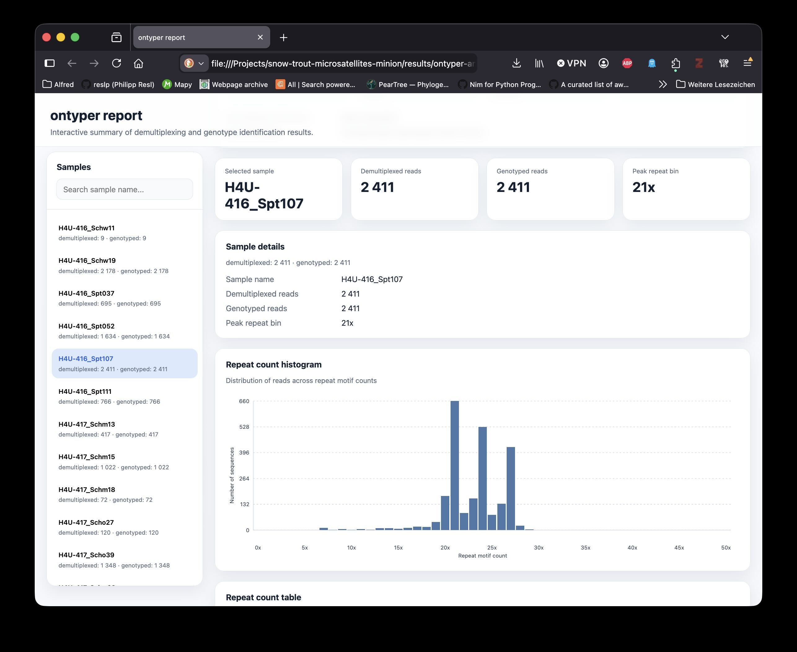

# ontyper

<p align="center">
  
</p>

Microsatellite genotyping toolkit for Oxford Nanopore sequencing data.

NOTE: This is currently in heavy development and everything is subject to change.

## Installation

First you need to clone the repository:

```bash
git clone git@github.com:reslp/ontyper.git
```

### As a global CLI tool (recommended)

```bash
# Install globally using uv tool (from local directory)
cd /path/to/ontyper
uv tool install .

# Or install directly from a git repository (once published)
# uv tool install git+https://github.com/username/ontyper.git

# The 'ontyper' command is now available globally
ontyper --help

# To upgrade later
uv tool upgrade ontyper

# To uninstall
uv tool uninstall ontyper
```


## Usage

<p align="center">
  
</p>

### Demultiplex reads

```bash
ontyper demultiplex -i reads.fasta -d demultiplex.txt -o output_dir/
ontyper demultiplex -i reads.fastq.gz -d demultiplex.txt -o output_dir/
```

### Identify genotypes

```bash
ontyper genotypes identify -d demultiplex.txt -i demultiplexed_dir/ > genotypes.tsv

# Or write the table directly to a file
ontyper genotypes identify -d demultiplex.txt -i demultiplexed_dir/ -o genotypes.tsv

# With detailed output (creates genotypes-detailed.tsv)
ontyper genotypes identify -d demultiplex.txt -i demultiplexed_dir/ --detailed -o genotypes.tsv
```

### Extract sequences for a specific genotype

```bash
ontyper genotypes extract -i reads.fasta -g genotypes-detailed.tsv -l TTMock01_Tth445 -n 20x
ontyper genotypes extract -i reads.fastq.gz -g genotypes-detailed.tsv -l TTMock01_Tth445 -n 20x
```

### Visualize genotype distributions

```bash
ontyper genotypes visualize -g genotypes.tsv -l TTMock01_Tth445
```

### Build an interactive HTML report

```bash
ontyper report -d demultiplexed_dir/ -g genotypes.tsv -p allele-calls.tsv -o report.html
```

**These features are currently in development and not yet available in the online version:**

### Build allele prediction features

```bash
ontyper genotypes features \
  --genotypes genotypes.tsv \
  --mapping sample_locus_mapping.csv \
  --true-alleles true_alleles.csv \
  -o training-features.csv
```

Omit `--true-alleles` to create prediction-only feature tables.

### Train an allele prediction model

```bash
ontyper genotypes train \
  --features training-features.csv \
  --model HistGradientBoostingClassifier \
  --modelfile allele-model.joblib \
  --group sample_id
```

### Predict alleles with a trained model

```bash
ontyper genotypes predict \
  --features prediction-features.csv \
  --modelfile allele-model.joblib \
  --predictions-out allele-scores.tsv \
  -o allele-calls.tsv \
  --top-k 6 \
  --prob-threshold 0.2
```

### Run integrated model-based genotype calling

```bash
ontyper genotypes call \
  --demfile demultiplex.txt \
  --indir demultiplexed_dir/ \
  --mapping sample_locus_mapping.csv \
  --modelfile allele-model.joblib \
  -o allele-calls.tsv
```


## Development

```bash
# Using pip (editable install)
pip install -e .

# Using uv in a virtual environment
uv venv
source .venv/bin/activate  # or .venv-mba/bin/activate on some systems
uv pip install -e .
```

```bash
# Install with dev dependencies
pip install -e ".[dev]"

# Run tests
pytest
```

